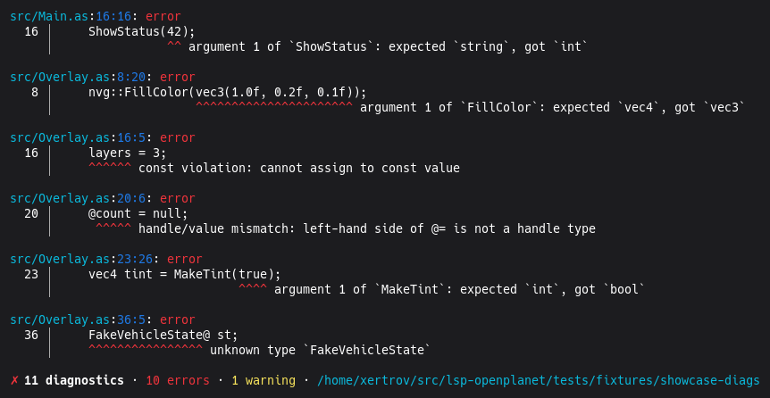
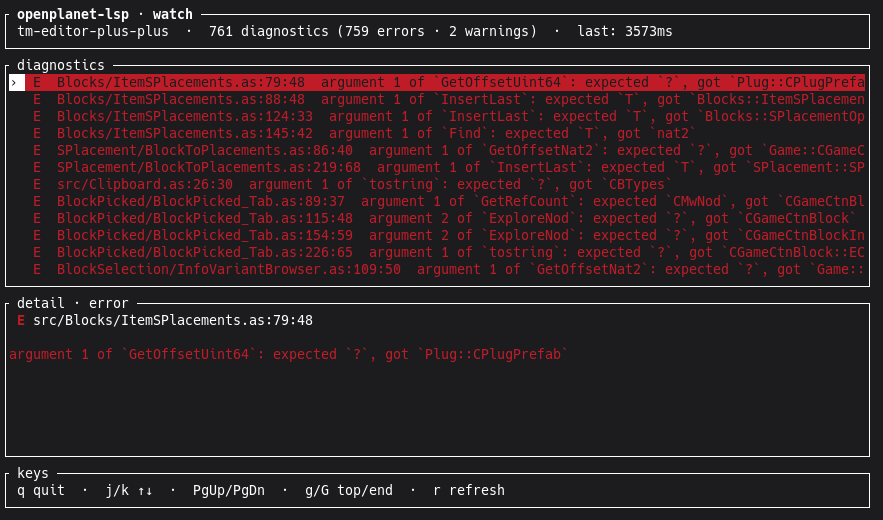

# openplanet-lsp





Language Server Protocol implementation for **Openplanet AngelScript**
(Trackmania / Openplanet plugins).

## Install

```bash
# npm (recommended for most users)
npm install -g openplanet-lsp

# cargo (crates.io)
cargo install openplanet-lsp

# or download a platform archive from
# https://github.com/clankercode/lsp-openplanet/releases
# extract `openplanet-lsp` somewhere on PATH (e.g. ~/.local/bin)
```

```bash
openplanet-lsp --version
openplanet-lsp --help
```

## Use as an LSP (editor)

`openplanet-lsp` speaks **JSON-RPC over stdio**.

| How you launch | What you get |
|----------------|--------------|
| Editor / non-TTY stdio (no args) | Language server |
| TTY, inside a plugin (`info.toml`) | Watch TUI (default) |
| `openplanet-lsp --lsp` or `lsp` | Force language server |
| `openplanet-lsp config` | TUI editor for workspace `.openplanet-lsp.toml` (`--global` for `~/.config/openplanet-lsp/config.toml`) |
| TTY, no plugin nearby | Short help (exit 2) |

Config (`~/.config/openplanet-lsp/config.toml` or workspace `.openplanet-lsp.toml`):

**Precedence.** Every key resolves through one ladder, highest first:

1. `initializationOptions` (your editor's LSP client settings)
2. CLI flags (`check --game-target`, `--unused`, `--no-gitignore`, …) — these
   ride the same layer as initializationOptions
3. per-root workspace `.openplanet-lsp.toml` (the plugin's own file)
4. the opened folder's `.openplanet-lsp.toml`, when it hosts several plugins
5. user global `~/.config/openplanet-lsp/config.toml`
6. auto-detection (Openplanet install folder, type DB, plugins dir)

Project config always beats machine config: a machine-wide `source_paths` or
`game_target` is a default your plugin can override, never the other way
round. `defines` is the one exception, and it does not compete — entries
ACCUMULATE across all layers and are applied last (prefix `-`/`!` to remove).

**Bad keys are per-key.** A key whose value has the wrong type, has an unknown
enum value, or does not exist is skipped with a warning naming the file, the
key and the expected value; every other key in the same file still applies.
Only a file that is not valid TOML at all is skipped whole — and that warns
too. Warnings go to stderr, and to the editor as `window/showMessage` under
the LSP.

```toml
# bare TTY default when no subcommand is given
default_mode = "tui"   # or "lsp"

# Game target — picks the preprocessor platform defines (#if TMNEXT / MP4 /
# TURBO / ...). Default "TMNEXT" (TM2020). Override for plugins that only
# support another game.
# game_target = "TMNEXT"

# Signature level whose SIG_* defines are live. Openplanet defines a
# signature macro when the current level is equal or BELOW that macro's level,
# so the levels are cumulative, not exclusive:
#   official  -> SIG_OFFICIAL
#   regular   -> SIG_OFFICIAL, SIG_REGULAR
#   school    -> SIG_OFFICIAL, SIG_REGULAR, SIG_SCHOOL
#   developer -> all four                                (default)
# Set it to check the plugin the way it compiles once signed — `#if
# SIG_DEVELOPER` blocks go dead below developer. Aliases: dev, reg, and the
# SIG_* token itself; an unknown value warns and falls through to the next
# lower config layer (or the permissive developer default). CLI `--signature
# MODE` wins over this.
# signature_mode = "developer"

# Host OS / game arch whose defines are live. Exactly one OS and one arch
# are live in a real process, and the defaults model a windows/64 client:
#   windows -> WINDOWS          (default)
#   wine    -> WINDOWS, WINDOWS_WINE   (as the game defines under Wine)
#   linux   -> LINUX
#   64 -> MANIA64   (default)      32 -> MANIA32
# CLI `--os OS` / `--arch ARCH` win over this.
# os_target = "windows"
# arch_target = "64"

# Build-shape defines (DEVELOPER, HAS_DEV, LOGS, SERVER), all default true
# so today's analysis set is unchanged; set false (or `--no-server` etc.)
# to narrow the run toward a real client build, which has none of them.
# developer_build = true
# has_dev = true
# logs = true
# server = true

# Extra preprocessor defines. ADDED to what game_target derives (TMNEXT,
# WINDOWS, MANIA64, SIG_*, ...) and to info.toml [script].defines — listing
# DEV here no longer drops TMNEXT and does not blank out the target-derived
# set (game platform, OS/arch, signature level, build flags).
# Prefix an entry with `-` or `!` to turn a define OFF (`-LOGS`); removals are
# applied after additions, so a removal wins. Entries ACCUMULATE across layers
# (user global, parent config, per-root config, initializationOptions), so a
# plugin adds to a machine-wide list instead of replacing it. Listing a
# platform selector of another game (`MP4` while game_target is TMNEXT)
# replaces the target's selectors rather than stacking on them, so exactly one
# `#if <platform>` family stays live — prefer game_target for picking a game.
# defines = ["DEV", "DEBUG_BROWSER", "-LOGS"]

# Which .as files to check, relative to the plugin root. Openplanet compiles a
# specific set; repos often keep non-compiled scripts (asset packs, fixtures,
# experiments) alongside src/. source_paths is an ALLOWLIST (wins if set);
# ignore_paths is a BLOCKLIST (used only when source_paths is absent); with
# neither, every .as under the root is checked (safe default). Omitted files
# are still read for one narrow purpose -- see honor_gitignore below.
# source_paths = ["src"]
# ignore_paths = ["OtherPacks", "vendor"]

# Root-relative search roots for the files listed in info.toml `exports` /
# `shared_exports` (default: ["src"]). An entry resolves as written, then under
# each search root, then with a leading search root STRIPPED -- so `Export.as`
# finds src/Export.as, and `src/Export.as` still finds Export.as after the file
# is moved up to the plugin root. Any deeper path in the entry is preserved
# (`src/Ex/Shared.as` -> `Ex/Shared.as`). This is what keeps a plugin that
# shuffles sources between src/ and the root from reporting "Export file not
# found" -- and, because export files are exempt from unused-declaration
# reporting, from reporting its whole public API as unused. Workspace
# .openplanet-lsp.toml wins over the user config; the CLI flag
# `check --plugin-files-search-path DIR` (repeatable) wins over both and
# REPLACES the list rather than adding to it.
# plugin_files_search_paths = ["src"]

# Honor .gitignore during .as discovery (default true). Files excluded by
# .gitignore rules at or below the plugin root -- plus a root-local
# .git/info/exclude -- are not parsed or diagnosed, matching what other
# language tooling (rust-analyzer, gopls, tsc) does: a file you believe is
# excluded should not produce squiggles. In practice this drops second copies
# of your own sources (.worktrees/, scratch probe dirs) that otherwise collide
# with the real ones. Rules ABOVE the plugin root are never read -- a plugin
# inside a bigger repo keeps its own checked set -- and a global gitignore or a
# `.ignore` file is not consulted, so nothing invisible to your repo can shrink
# the set. Set false when gitignored files are still COMPILE-CRITICAL, e.g.
# dev-loop codegen output written into the tree but never committed; the CLI
# flag `check --no-gitignore` does the same for one run. Workspace
# .openplanet-lsp.toml wins over the user config; the flag wins over both.
# Orthogonal to the two lists above: the checked set is
# discovered - gitignored - ignore_paths (or intersected with source_paths).
# Whichever way a file is omitted, it is still read for ONE purpose: the
# unused-declaration pass records what it REFERENCES, so a function whose only
# caller lives in a gitignored (or filtered-out) file is not reported "never
# used". The game compiles those files, so that warning would be wrong. Their
# own declarations stay invisible and they never get diagnostics of their own.
# honor_gitignore = true

# Namespace-shortcut completions (old vscode-openplanet-angelscript QoL):
# typing `Beg` suggests `UI::Begin` etc. at identifier positions. Built-in
# defaults are `UI` + `Math`; `shortcut_namespaces` sets your own custom
# list, replacing the default `UX` + `MathX`. Set
# `shortcut_disable_default_namespaces = true` to drop UI/Math entirely
# (leaving only your custom list, or none); `shortcut_match_enums = true`
# also suggests enums and enum values. Namespace variables are never
# matched — the typedb has no global-variable data source.
# shortcut_namespaces = ["UX", "MathX", "Net"]
# shortcut_disable_default_namespaces = false
# shortcut_match_enums = false

# Dependency defines. Openplanet defines DEPENDENCY_<ID> only for
# dependencies it actually LOADED, so openplanet-lsp does the same: a
# dependency declared in info.toml but not installed here gets no define, and
# its `#if DEPENDENCY_X` code is masked out exactly as the game masks it.
# <ID> is the plugin id (the folder name, or a .op file's base name) in
# uppercase with spaces, dashes and periods replaced by underscores —
# `static-loading-screen` becomes DEPENDENCY_STATIC_LOADING_SCREEN. Note that
# mapping collides: my-plugin and my.plugin both give MY_PLUGIN. That is
# Openplanet's own rule, so it is reproduced rather than "fixed"; declaring
# two ids that collapse together warns.
# To check the OTHER branch state — your plugin ships to users who do have the
# dependency — name the macro as a define_matrix axis (below) or add it to
# `defines`. Both override the resolution gate deliberately.

# Define matrix (CLI `check` only; the LSP server keeps one live define
# set). define_matrix lists axes toggled on/off on top of the base define
# set — check runs the cross-product of all combos through the full
# pipeline. Diagnostics are labeled with the combo they fired in
# ([DEV] / [seen in: {} | DEV] in plain/pretty output, a "combo" array
# in --format json), and duplicates across combos are merged into one
# entry. The platform selectors {TMNEXT, MP4, TURBO} form an implicit
# mutually-exclusive group whenever ≥2 of them are axes.
# define_matrix = ["DEV", "DEPENDENCY_MLHOOK"]

# Mutually-exclusive define groups: at most one member is defined per
# combo; violating combos are skipped (never analyzed).
# define_groups = [["FEATURE_A", "FEATURE_B"]]

# Explicit combo pin list: when present (even []), the cross-product is
# skipped entirely and ONLY these combos are checked.
# define_combinations = [[], ["DEV"], ["DEV", "DEPENDENCY_MLHOOK"]]

# Matrix size cap (default 16). A cross-product expanding past the cap is
# a hard error — pin combos with define_combinations or raise the cap.
# define_matrix_max_combinations = 16

# Extra names the unused-declaration pass treats as runtime-invoked
# callbacks, on top of the built-in Openplanet list (Main, Render,
# OnKeyPress, ...). For frameworks that dispatch user-declared functions
# by NAME REFLECTION — MLHook calling OnCounterUpdate, say — nothing in
# the plugin references them, so a fixed list can't know they're live.
# Entries are literal names or a single `*` wildcard: `On*`, `*Update`,
# `On*Update`, or bare `*`. Not a glob, not a regex. Matches unqualified
# names of free functions at file top level (class methods and namespaced
# functions stay in scope), and exempts their parameters too. Additive —
# it never drops the built-ins. Workspace .openplanet-lsp.toml wins over
# the user config; lists don't merge, the winning file's list is the list.
# unused_callbacks = ["OnCounterUpdate", "OnThing*"]

# Unused functions / vars / parameters / class members. Default "info"
# (B090): `check` folds info-level findings out of its listing into a
# per-kind hidden count in the summary — `--show-info` lists them — so a
# normal run stays quiet; editors still see them (listed in the problems
# panel, faded via the Unnecessary tag). "ignore" turns the pass off.
# "warn" restores the pre-B090 visible warnings. "error" emits ERROR
# diagnostics so `check` fails without --warnings-as-errors. "info" and
# "hint" never fail the run, not even under --warnings-as-errors: "info"
# stays listed in an editor's problems panel, "hint" drops out of it and
# leaves only the greyed-out range. Every finding is tagged Unnecessary
# at all levels, so editors that honour the tag (VS Code:
# `editor.showUnused`) fade the declaration regardless of level.
# CLI `--unused ignore|hint|info|warn|error` and `--no-unused` win over
# this; workspace .openplanet-lsp.toml wins over the user config.
# unused = "info"

# Grey out `#if` branches the current defines switch off, the way an IDE
# fades `#if 0` in C. Default "hint": the dead body gets a HINT diagnostic
# tagged Unnecessary, so an editor fades it (VS Code: `editor.showUnused`)
# without listing it in the problems panel. "info" also lists it; "ignore"
# marks nothing. LSP-ONLY — `check` and the TUI never report these, at any
# level, so a plugin full of `#if MP4` does not drown the CLI output. There
# is deliberately no warn/error level: a branch that is off for your target
# is dead by design, not a defect.
# inactive_regions = "hint"

# Human `check` output groups diagnostics by severity. Default "last":
# warnings / info / hints first, then errors (so a flood of warnings does
# not bury the two errors you care about). "first" puts errors first;
# "off" keeps analysis order. JSON is never regrouped.
# CLI `--errors last|first|off` wins over this; workspace
# .openplanet-lsp.toml wins over the user config.
# errors = "last"

# Any `--define` CLI flag collapses the matrix back to a single-combo run.
# `check --game-target NAME` and `check --signature MODE` override the two
# selectors above for one run (both wins over these files).
```

Point your editor’s AngelScript / Openplanet language client at the binary
(stdio, **no args** — editors attach pipes, so bare launch stays LSP).

### Generic LSP client settings

| Setting | Value |
|---------|--------|
| Command | `openplanet-lsp` (or full path) |
| Args | _(none)_ |
| Transport | **stdio** |
| File types | typically `.as`, `.op`, Openplanet plugin trees |

Workspace root should be the **plugin directory** (the folder that contains
`info.toml` and your `.as` sources).

### VS Code / Cursor / similar

Use any generic LSP extension (e.g. [vscode-languageclient](https://code.visualstudio.com/api/language-extensions/language-server-extension-guide)
wrapper) or an Openplanet-specific extension that shells out to `openplanet-lsp`.
Minimal `settings.json` shape for a generic client:

```json
{
  "myAsLsp.server.path": "openplanet-lsp",
  "myAsLsp.server.args": [],
  "myAsLsp.trace.server": "off"
}
```

Exact keys depend on the extension; the important part is **command =
`openplanet-lsp`, no args, stdio**.

### Neovim (nvim-lspconfig style)

```lua
vim.api.nvim_create_autocmd("FileType", {
  pattern = { "angelscript", "as" },
  callback = function()
    vim.lsp.start({
      name = "openplanet-lsp",
      cmd = { "openplanet-lsp" },
      root_dir = vim.fs.root(0, { "info.toml", ".git" }),
    })
  end,
})
```

### Helix

In `~/.config/helix/languages.toml`:

```toml
[[language]]
name = "angelscript"
scope = "source.angelscript"
file-types = ["as"]
language-servers = ["openplanet-lsp"]

[language-server.openplanet-lsp]
command = "openplanet-lsp"
```

### What the server provides

Depends on build features, but typically includes:

- diagnostics (parse / typecheck where available)
- hover, go-to-definition, references, document symbols
- completion and signature help
- formatting / folding / semantic tokens (where implemented)

Optional config: place an Openplanet / LSP config near the workspace (see
project docs) or pass environment overrides used by the CLI.

Background update probes run about once per day and can surface an editor
notification when a newer release is available.

**Restart after an upgrade.** A language server started before an upgrade goes
on answering from the old binary until the editor happens to restart it, which
can be hours. So the server stats its own executable path every 30s and reacts
when the file there is replaced — by a self-update, a package manager, or a
manual install. It acts only when nothing is in flight, and exactly once per
replacement, never repeatedly.

What it does is the client's choice, via `initializationOptions`:

| `on_binary_replaced` | Behaviour |
|----------------------|-----------|
| `"exit"` _(default)_ | Exit cleanly once idle. Editors that respawn a stopped server (VS Code's `LanguageClient`, with bounded retries) come straight back up on the new binary. |
| `"notify"` | Send an `openplanet/serverBinaryReplaced` notification and keep serving, leaving the restart entirely to the client. Only useful if your client implements that method. |
| `"off"` | Do nothing. Keeps a long-lived process on the binary it started with. |

The notification carries `path`, `runningVersion` (the *stale* version still
serving) and the `previous` / `current` file stamps. Note that an install
scheme which upgrades by repointing a **symlink** at a new immutable file (Nix,
and other content-addressed stores) is not detected: the path the server can
see is already symlink-resolved and its file never changes.

## CLI

```text
openplanet-lsp [FLAGS]              # bare: TTY+plugin → watch TUI; else LSP
openplanet-lsp --lsp | lsp          # force language server
openplanet-lsp check [OPTIONS] [PATH]
openplanet-lsp check --watch [PATH] # live diagnostics TUI
openplanet-lsp update [OPTIONS]
```

### `check` — offline plugin diagnostics

Typecheck / lint an Openplanet plugin tree without an editor:

```bash
# one-shot (pretty on TTY; plain when piped / NO_COLOR)
openplanet-lsp check /path/to/plugin
openplanet-lsp check --format plain ./tests/fixtures/showcase-diags
openplanet-lsp check .                  # PATH = plugin root or a .as file
openplanet-lsp check --help

# live watch TUI (re-checks on *.as / *.inc / info.toml changes)
openplanet-lsp check --watch .
# or, from inside a plugin directory on a TTY:
openplanet-lsp
```

#### Watch TUI

Interactive diagnostics browser (requires a real TTY).

| Key | Action |
|-----|--------|
| `j` / `k` or arrows | Move selection |
| `PgUp` / `PgDn` / Space | Page |
| `g` / `G` (Home/End) | Top / end |
| `Shift+J` / `Shift+K` | Scroll the **detail** box (long messages) |
| `c` | Toggle **compact** ↔ **relaxed** density |
| `r` | Manual refresh |
| `q` / Esc / Ctrl-C | Quit |

- **Compact:** one row per diagnostic (message ellipsized — the location shrinks
  first, so the message always keeps a readable share of the row).
- **Relaxed:** location + message; right-aligned `› fragment ‹` on the location row.
  The selected row spills its message onto a second line when it does not fit.
- **Detail:** pretty source excerpt with carets for the selected item. The
  message wraps to the pane width and the box grows to fit; past its cap the box
  scrolls with `Shift+J` / `Shift+K` and the title shows the visible range.
- Auto-refresh watches `*.as`, `*.inc`, and `info.toml` under the plugin root. If the watcher fails to start, the header shows `watch off · r to refresh`.
- Header status: `checking…` while a run is in flight; `checked in N ms` when ready; last-good list is labeled **stale** during a check or after failure.
- Checks run off the UI thread so navigation stays responsive.

Exit codes for **one-shot** `check`: **0** if no errors (warnings allowed); **1** if diagnostics include errors; **2** on usage / IO failures.

Interactive **`check --watch`**: exits **0** on normal quit; **2** on setup/runtime failure (does not return the last diagnostic status).

Useful options (see `--help` for the full list):

| Flag | Meaning |
|------|---------|
| `--watch` | Live TUI; re-check on file changes |
| `--format plain\|pretty\|auto` | One-shot output style (ignored with `--watch`) |
| `--errors last\|first\|off` | Group errors after / before / interleaved with other diagnostics (default last; ignored for JSON) |
| `--typedb-dir <DIR>` | Load Openplanet type database from DIR |
| `--no-typedb` | Skip type DB (parse-only / limited checks) |
| `--show-info` | List INFO/HINT diagnostics instead of folding them into the summary's per-kind hidden count (unused findings are info by default since B090; JSON always carries everything) |
| `--openplanet-version <V[,V...]>` | Check against these Openplanet versions (default: the installed one). Several versions check all of them at once; diagnostics that fire on only some targets get an `[op V]` label, and missing symbols other recorded versions know carry "added in" / "removed in" notes |
| `--typedb-versions-dir <DIR>` | Root of recorded typedb snapshots, one `<version>/` subdirectory each (see `tests/fixtures/typedb-versions/`) |
| `--plugins-dir <DIR>` | Extra Openplanet plugins dir for dependency exports |

Unless `--no-typedb` is passed, every run states which type database it used
— see [`typedb`](#typedb--type-db-freshness) below.

### `typedb` — type-DB freshness

The checker judges your code against Openplanet's own type databases
(`OpenplanetCore.json` + the game dump, e.g. `OpenplanetNext.json`, plus
`Openplanet.h` where present — it is the only source for the engine's
module-level enums, which the JSON dump's shape cannot represent). When the
DB and the running game disagree, the LSP is *confidently wrong* rather than
merely silent — so which DB loaded is worth being able to see.

**You normally need to do nothing.** `openplanet-lsp` auto-detects your
Openplanet install (`~/OpenplanetNext`, or the variant folder matching
`game_target`) and reads its DBs directly. Openplanet refreshes those files
on game launch, so your checks already track your own game build. Every
`check` run now says which one it used:

```
type db: op=1.29.5 (next, Public, 1234ad9e)  game op=1.29.5  mp=2026-02-03 03:51:19
```

`--format json` carries the same stamps as a `typedb` object
(`op`, `mp`, `game_op`) instead, and the language server logs the line at init.

```bash
openplanet-lsp typedb status                     # which DBs resolve, and from what build
openplanet-lsp typedb status --from ~/OpenplanetTurbo
openplanet-lsp typedb status --json

# symbol-level parity: what changed between two DB directories
# (NEW_DIR defaults to the auto-detected install)
openplanet-lsp typedb diff tests/fixtures/typedb
openplanet-lsp typedb diff OLD_DIR NEW_DIR --json

# harvest both DBs out of a local install (DRY RUN by default)
openplanet-lsp typedb refresh --into tests/fixtures/typedb
openplanet-lsp typedb refresh --into tests/fixtures/typedb --yes
```

`diff` compares what the checker actually consumes — method and overload
signatures (including `&out` flags and parameter defaults), property types
and writability, inheritance, single-argument constructor conversions, and
enum values. A doc-only DB refresh therefore reports zero drift.

**Nothing in this command family touches the network.** There is no upstream
DB download endpoint; DBs are only ever read from a local install. `refresh`
writes nothing without `--yes`, requires an explicit `--into` (no implicit
write path), writes the two DB JSON filenames plus `Openplanet.h` only when
that co-located header exists, and never deletes.

#### Maintainer flow (repo fixture DBs)

The repo ships fixture DBs under `tests/fixtures/typedb` for tests and
`--typedb-dir`. To bring them up to a newer game build:

```bash
just typedb-refresh         # dry run: shows the symbol diff, writes nothing
just typedb-refresh-apply   # writes the two DB JSON files, plus Openplanet.h when present
just test                   # includes the fixture shape guard
```

`just typedb-diff` is the parity check on its own, and `just typedb-guard`
runs the anti-drift guard (also a named CI step): version stamps must look
like versions, entry counts must clear floors, and both DB JSON files must
survive a full load (with `Openplanet.h` included when present). That catches
the dangerous case — a well-formed but *empty* DB that parses, loads, and
silently disables every type-aware diagnostic.

Per-game-version DB selection (keeping several game builds' DBs side by side)
is deliberately not implemented: `game_target` already selects the install
folder, and everyone has exactly one install.

### `update` — self-update

```bash
openplanet-lsp update --check              # query latest + write status file
openplanet-lsp update --check --source github
openplanet-lsp update --check --source crate
openplanet-lsp update --status             # print last saved status (offline)
openplanet-lsp update                      # apply via detected install method
openplanet-lsp update --force              # reinstall even if already latest
```

**Version source** (`--source`, default `npm`):

| Value | Channel |
|-------|---------|
| `npm` | registry.npmjs.org (default) |
| `crate` | crates.io (`openplanet-lsp`) |
| `github` | latest GitHub Release tag |

**Install method** is detected from the binary path:

| Method | How update applies |
|--------|--------------------|
| npm / pnpm / yarn / bun (global or local) | package-manager install |
| cargo | `cargo install --git … --force` |
| standalone (`~/.local/bin`, manual extract, …) | download GH Release archive + replace binary |
| development (`target/release/…`) | not auto-updated — rebuild yourself |

Status output looks like:

```text
current:  0.3.0 (install type: standalone)
latest:   0.3.0 (source checked: npm)
status:   up to date
```

Status file: `~/.config/openplanet-lsp/update-status.json`
(override with `OPENPLANET_LSP_CONFIG_DIR`).

### Dev / CI env overrides

| Env | Effect |
|-----|--------|
| `OPENPLANET_LSP_VERSION` | Pretend current version for compare (`--version` stays real) |
| `OPENPLANET_LSP_LATEST_VERSION` | Skip network; treat as latest |
| `OPENPLANET_LSP_UPDATE_PACKAGE` | Install target(s) instead of `@latest` |
| `OPENPLANET_LSP_PACKAGE_MANAGER` | Force `npm` / `pnpm` / `yarn` / `bun` |
| `OPENPLANET_LSP_EXE` | Fake binary path for install-method detection |
| `OPENPLANET_LSP_RELEASE_ARCHIVE` | Local `.tar.gz`/`.zip` for standalone apply tests |

## Build from source

```bash
cargo build --release
./target/release/openplanet-lsp --help
cargo test
```

### Hermetic test gate

`DEPENDENCY_<ID>` is defined only when the dependency actually **resolves**, so
a test can quietly start depending on which plugins exist in the author's
`~/OpenplanetNext/Plugins` — passing locally and failing for everyone else,
looking like flakiness rather than a hermeticity bug.

```bash
just test                     # normal run — what you iterate against
just test-hermetic            # same suite, HOME/USERPROFILE isolated (also a CI step)
just test-hermetic-selftest   # proves the gate can actually fail
```

`just test-hermetic` builds with `cargo test --no-run` and then executes each
test binary directly with `HOME` and `USERPROFILE` pointed at a fresh empty
directory (cargo itself cannot run under a fake `HOME` — rustup resolves the
toolchain through it). That covers both HOME-derived surfaces: the auto-detected
install dir and `~/.config/openplanet-lsp/config.toml`.

It also **unsets `XDG_CONFIG_HOME`, `APPDATA` and every `OPENPLANET*`
variable** for the run. Those win over `HOME` — `OPENPLANET_REAL_PLUGINS_DIR`
is passed straight through as `--plugins-dir` — so exporting one (which is what
they are for) would otherwise hand a real install back to a run whose `HOME` is
a sandbox. Tests gated on them take their documented skip path here; use
`just test` when you want them. Both recipes need `python3`, as the `tui-*`
recipes already do.

A test that needs a real install is fine, but must say so — provision it inside
the test's own fixture dir with an explicit `--plugins-dir`, or mark it
`#[ignore = "<reason>"]`. A test that needs one *by accident* is the bug.

**It does not catch everything.** Absolute paths outside `HOME` (a hardcoded
`--plugins-dir /opt/...`) are untouched by the isolation, and a test depending
on a plugin being *absent* is green under the gate and red on a developer box.
Both limits are kept executable as `uncaught_*` canaries in
`tests/hermeticity_canary.rs`; the full list is in the header of
`scripts/test-hermetic.py`.

## Smoke tests

```bash
./scripts/release/smoke-local.sh
./scripts/release/smoke-self-update.sh

FROM_VERSION=latest TARGET_VERSION=latest \
  ./scripts/release/smoke-self-update-registry.sh
# or Actions → "self-update-matrix"
```

## Release / distribution

See **[RELEASE.md](RELEASE.md)** (keep it accurate when tooling changes):

- multi-platform GitHub Release binaries (Linux / macOS / Windows × x64 / arm64)
- npm (`openplanet-lsp` + platform packages) via OIDC trusted publishing
- crates.io via Trusted Publishing (`release.yml` + `id-token: write`)
- version bump, tag, changelog, post-CI `gh release edit`
